<div align="center">

<br>

# Tuned in Markets

### The market, on your own screen.

**A live dashboard for Indian and US stocks that runs on your computer.**<br>
Intraday smart money, a sector map, market health, long-term screens, a backtested swing lab and optional AI deep research.<br>
No account. No subscription. Nothing leaves your machine except the requests it makes to public data sources.

<p>
<a href="docs/INSTALL.md#mac"></a>
<a href="docs/INSTALL.md#windows"></a>


<a href="LICENSE"></a>
</p>

<p>
<a href="#install"><b>Install</b></a> &nbsp;|&nbsp;
<a href="#the-tour"><b>Tour</b></a> &nbsp;|&nbsp;
<a href="#how-it-works"><b>How it works</b></a> &nbsp;|&nbsp;
<a href="#deep-research-with-your-own-ai-key"><b>AI research</b></a> &nbsp;|&nbsp;
<a href="docs/READING-GUIDE.md"><b>Reading guide</b></a> &nbsp;|&nbsp;
<a href="#faq"><b>FAQ</b></a>
</p>

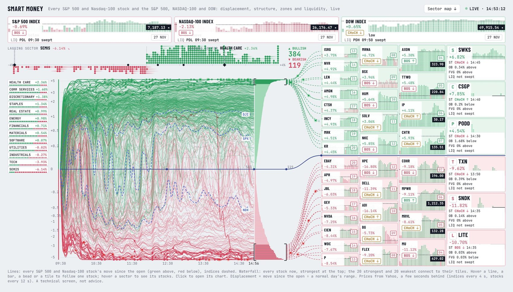

</div>

<br>

> [!WARNING]
> **Personal use only. Not financial advice. You are responsible for any trades you place.**
> Prices can trail the exchange. Scores, signals, backtests and AI reports are mechanical outputs and can be wrong. Read the [full notice](#important-notice) before you rely on anything here.

---

## At a glance

| | |
|---|---|
| **Markets** | India (NSE) and US, switched with one button |
| **Live tape** | Every F&O stock, or every S&P 500 and Nasdaq-100 stock, refreshed every 3 to 15 seconds |
| **Breadth coverage** | About 3,000 NSE instruments and about 11,000 US instruments |
| **Swing Lab** | 23 strategies tested after costs on five years of data: 6.3 lakh simulated trades in India, 1.94 million in the US |
| **Long-term screens** | Nifty 500 and S&P 1500, scored on quality, growth, value and trend from reported figures |
| **AI research** | Optional. Your own key. About 15 cents for an in-depth run |
| **Footprint** | About 240 MB of memory and a few percent of one CPU core once warmed up |
| **Cost** | Free. MIT licensed |

## Contents

[Why it exists](#why-it-exists) · [The tour](#the-tour) · [How it works](#how-it-works) · [Install](#install) · [Update](#update) · [First run](#first-run-and-warm-up) · [A day with it](#a-trading-day-with-it) · [Deep research](#deep-research-with-your-own-ai-key) · [Privacy](#privacy-and-security) · [Project layout](#project-layout) · [FAQ](#faq) · [Notice](#important-notice) · [Licence](#licence)

---

## Why it exists

Market tools usually fall into two camps: a broker terminal that shows everything and explains nothing, or a subscription site that explains a little and sells the rest. Tuned in Markets takes a different line.

- **One page, one picture.** Intraday structure, sector rotation, breadth, fundamentals and a tested swing system sit on a single scrolling page. Click any stock anywhere and the same chart opens.
- **It shows its work.** Every tag, score and colour is defined in the [reading guide](docs/READING-GUIDE.md). Backtests state their costs, their survivorship bias and their sample sizes on the page itself.
- **It is yours.** It runs on your computer, keeps your keys in a file only you can read, and talks straight to public data sources. There is no server of ours in the middle, and nothing to sign up for.
- **It is honest about being a screen.** It is a research tool. It does not place orders and it does not give advice.

---

## The tour

### Smart Money: who is moving right now

Every F&O stock in India, or every S&P 500 and Nasdaq-100 stock in the US, drawn as a line of its move since the open and scaled against that stock's own normal daily range. The twenty strongest and twenty weakest are lifted out as live tiles with their latest **break of structure**, **change of character**, **order block**, **fair value gap** and **liquidity sweep**.

<table>
<tr>
<td width="50%">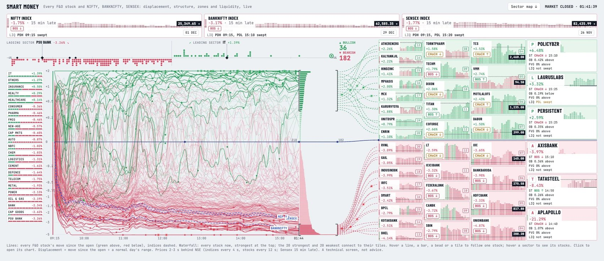<br><sub><b>India.</b> F&O stocks, Nifty, Bank Nifty and Sensex.</sub></td>
<td width="50%"><br><sub><b>US.</b> S&P 500 and Nasdaq-100 stocks, three indices.</sub></td>
</tr>
</table>

Click any tile or line for a full chart: zones, VWAP, an opening range, a plain-language reading of the structure and, if you switch it on, every past swing trade with its stop and target.

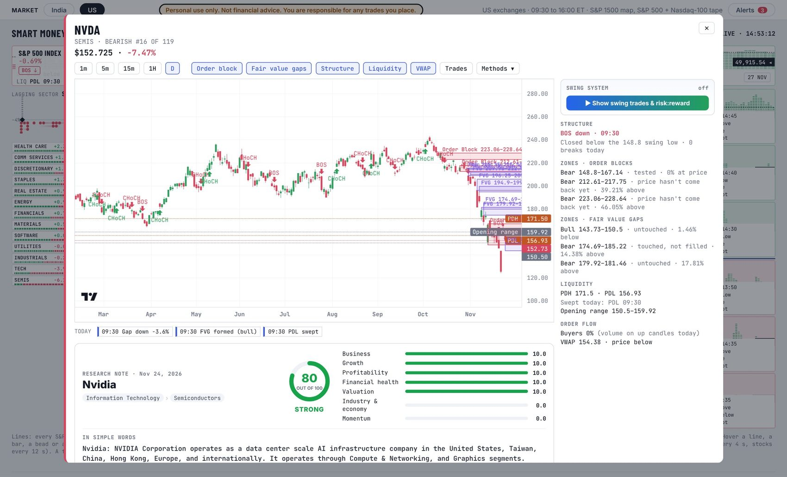

### Sector Map: where the money is rotating

Twenty sectors and themes as bubbles. Height is the move, size is market value, and the glowing line is the benchmark. Replay the day, switch to a week, a month or three months, and open a sector to see the stocks inside. A side panel ranks themes beating the index and shows who is climbing or slipping in the ranks.

<table>
<tr>
<td width="50%">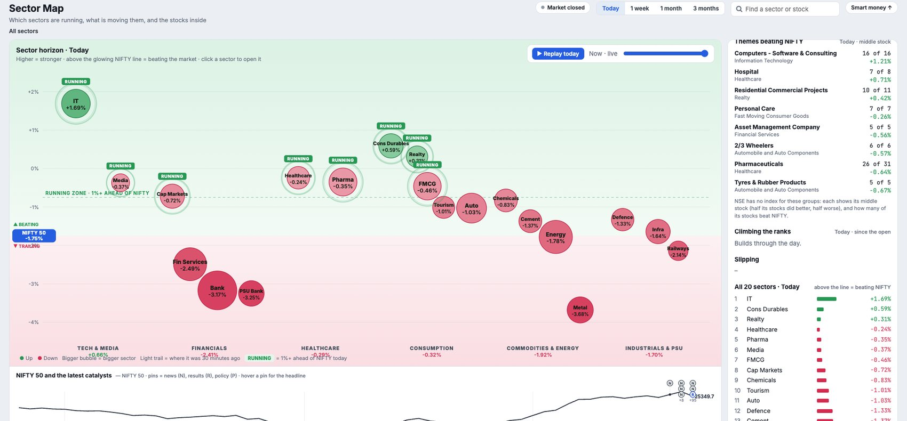<br><sub><b>India</b> against Nifty 50.</sub></td>
<td width="50%">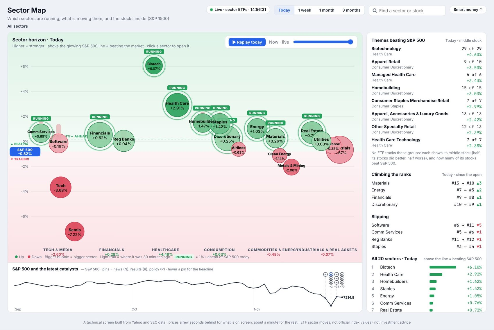<br><sub><b>US</b> against the S&P 500.</sub></td>
</tr>
</table>

### Market Health: is the rally broad?

The share of stocks above their 200-day and 50-day averages, new highs against new lows, advancers against decliners, the fear gauge and the advance-decline line. India adds **FII and DII cash flows**, the day's biggest bulk and block deals and option-chain walls straight from NSE.

<table>
<tr>
<td width="50%">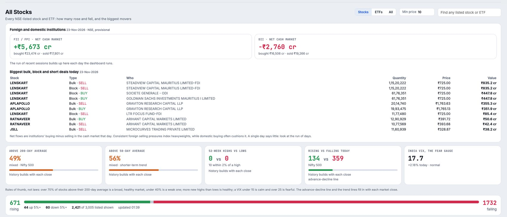<br><sub><b>India</b> with institutional flows and deals.</sub></td>
<td width="50%">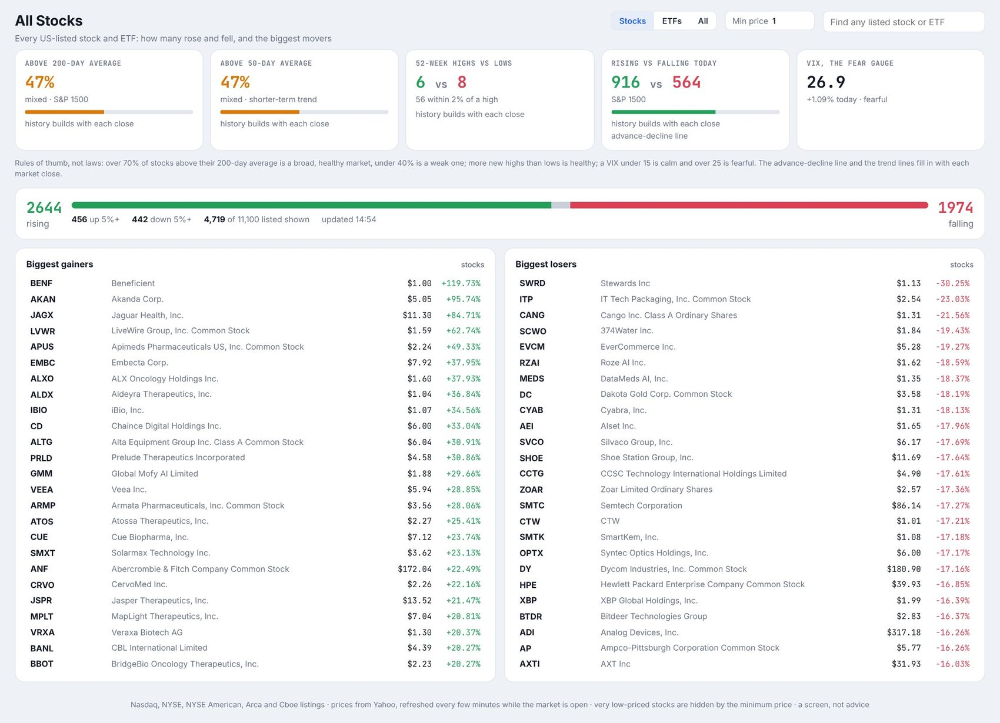<br><sub><b>US</b> breadth and biggest movers.</sub></td>
</tr>
</table>

### Long Term: quality, growth, value, trend

Companies ranked from reported figures, with sortable columns, sector and size filters, a "profitable only" switch and a watchlist. A stock's page adds a plain-words company note: business, results, valuation against its own five-year history, insiders, holders and earnings. US figures come straight from SEC filings, and India's from Yahoo's statements.

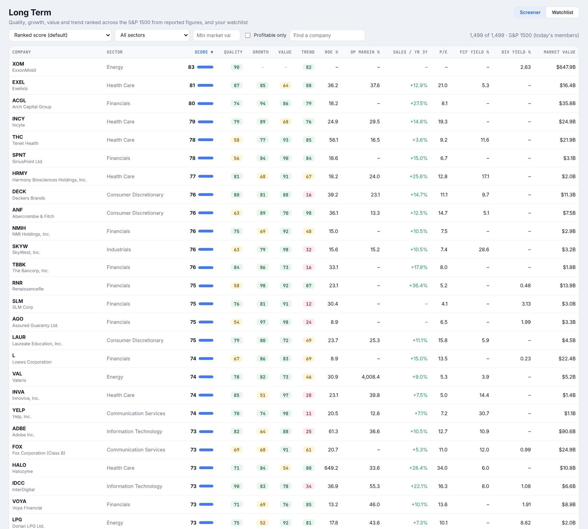

### Swing Lab: a system you can inspect

A cash-account swing system, 2 to 40 day holds, tested on five years of stocks after trading costs, against an equal-weight universe and the index. It shows what is set up today, what triggered at the last close and the open trades, and which kinds of stocks it has worked in. It states its limits on the page: survivorship bias, small samples and fill costs.

<table>
<tr>
<td width="50%">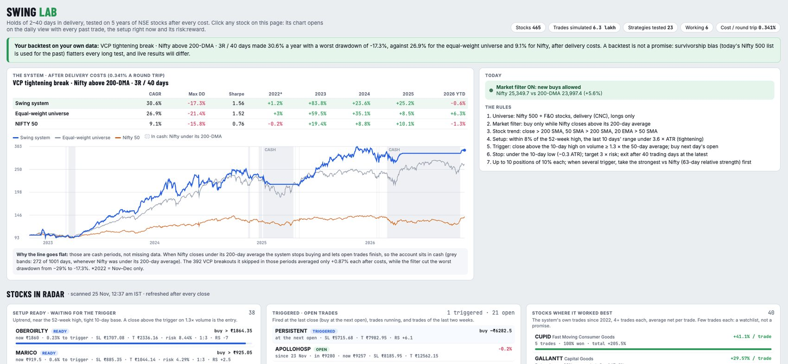<br><sub><b>India</b>: delivery trades, Nifty 200-day filter.</sub></td>
<td width="50%">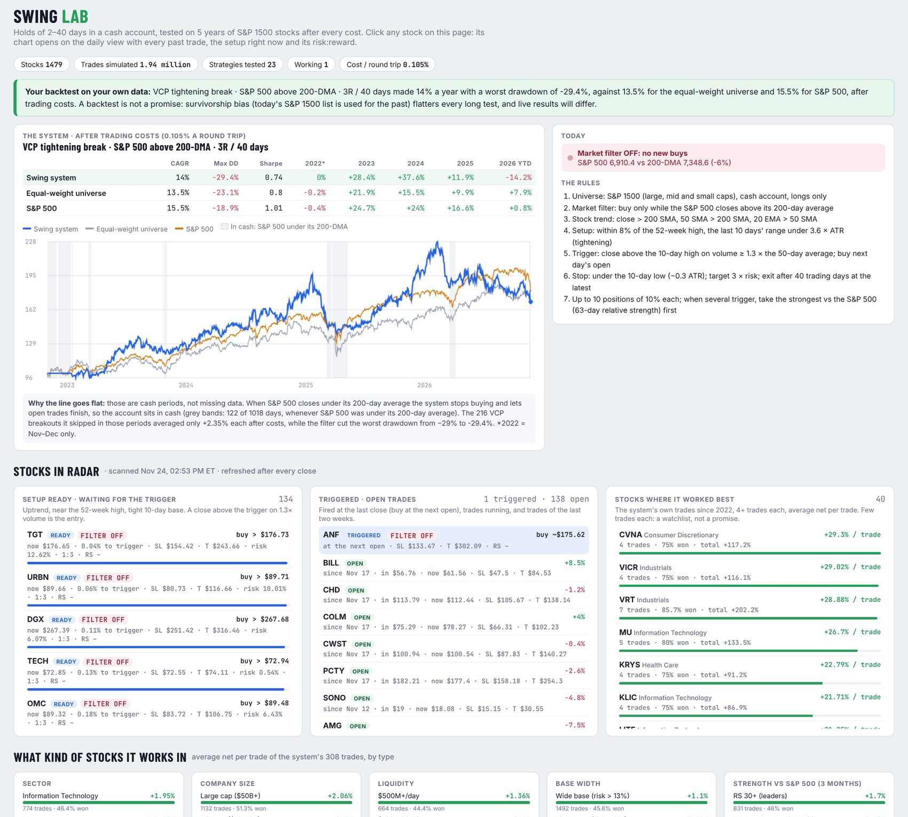<br><sub><b>US</b>: S&P 500 200-day filter.</sub></td>
</tr>
</table>

### Alerts

The bell collects new structure breaks, liquidity sweeps and big moves as they happen. Click an alert to open that stock's chart. Browser notifications are optional.

---

## How it works

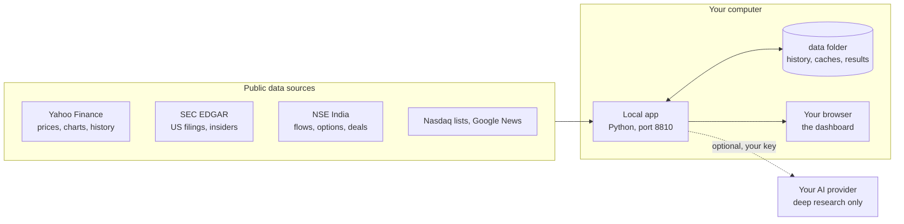

- **Local first.** A small Python web server on your machine fetches public data, does all calculations itself and serves the page to your browser. Everything it learns is kept in a `data` folder you can delete at any time.
- **Self-pacing.** The app limits its own request rate, keeps the live tape on a lane of its own so bulk downloads cannot freeze prices, and backs off when a source says slow down.
- **Self-building.** On first run it downloads five years of history and runs the Swing Lab backtest by itself, then refreshes weekly.

| Source | Used for |
|---|---|
| Yahoo Finance | Live prices, charts, daily history, India fundamentals |
| SEC EDGAR | US company filings, insider forms, bulk fundamentals |
| NSE India | FII and DII flows, bulk and block deals, option chains, holidays |
| Nasdaq and Wikipedia lists | Index membership (S&P 1500, Nasdaq-100) |
| Google News | Headlines for sectors and stocks |

---

## Install

You need a Mac or Windows computer, an internet connection and about 1 GB of space. No coding and no accounts.

<table>
<tr>
<td width="50%" valign="top">

####  &nbsp;Mac

1. Install **Python 3** from [python.org/downloads](https://www.python.org/downloads/). When it finishes, double-click **Install Certificates.command** in the folder that opens.
2. On this page choose **Code, Download ZIP**, then double-click the ZIP.
3. Open **Terminal** and run:
   ```bash
   cd ~/Downloads/tuned-in-markets-main
   bash install.sh
   ```
4. Start it:
   ```bash
   bash run.sh
   ```

</td>
<td width="50%" valign="top">

####  &nbsp;Windows

1. Install **Python 3** from [python.org/downloads](https://www.python.org/downloads/). On the first screen tick **Add python.exe to PATH**.
2. On this page choose **Code, Download ZIP**, then right-click the ZIP and **Extract All**.
3. Open the folder `tuned-in-markets-main` and double-click **`install.bat`**. If Windows warns, choose **More info, Run anyway**.
4. Start it by double-clicking **`run.bat`**.

</td>
</tr>
</table>

The dashboard opens at **http://localhost:8810**. Keep the window open, because closing it stops the app. The installer asks once for your name and email, which the US regulator's data service requires of everyone who fetches its filings by program. They are saved only in the `.env` file on your computer. Press Enter to skip and the app asks again in the browser.

The full guide, with an error table, is in [docs/INSTALL.md](docs/INSTALL.md).

<details>
<summary><b>Let your AI assistant do the install with you</b></summary>

<br>

Open **ChatGPT**, **Claude**, **Gemini** or **Copilot**, paste this, and replace the bracket with Mac or Windows. It will guide you one step at a time.

```text
I want to install an open-source app called Tuned in Markets on my computer.
Its address is https://github.com/atomicpillar/tuned-in-markets
I am not technical and I use [Mac / Windows]. Please read the README and docs/INSTALL.md
in that repository first, then guide me ONE step at a time. Ask me to paste what I see after
each step. If something fails, ask for the exact error text and fix it with me.
Never ask me to paste any API key into this chat.
```

Describe what you see on your screen, or paste the text of an error. Never paste an API key or your `.env` file into any chat.

</details>

---

## Update

New versions fix bugs and add features. To update, stop the app (Ctrl+C), then run the update script. It downloads the latest version and replaces the program files. Your keys (`.env`), history and watchlist (`data`) and settings are kept.

| | |
|---|---|
| **Mac** | `cd ~/tuned-in-markets && bash update.sh` |
| **Windows** | double-click **`update.bat`** |

Then start the app again. If you installed before the update script existed, run this once instead and it sets itself up:

```bash
cd ~/tuned-in-markets && curl -fsSL https://raw.githubusercontent.com/atomicpillar/tuned-in-markets/main/tools/update.py -o tools/update.py && .venv/bin/python tools/update.py
```

---

## First run and warm-up

Prices appear within about a minute. Everything else is built in the background and fills in as it finishes. A small orange **Warming up** note in the top bar shows the app is still loading.

| Moment | Plan for | What is happening |
|---|---|---|
| **The very first run** | 30 to 40 minutes | Five years of history and the Swing Lab backtest are built once |
| **A normal restart** | 12 to 20 minutes | Price history, scans, breadth and the sector map settle |
| **Already running** | none | Open the page |

**Active traders: start it 20 minutes before the open, or leave it running.** Click the orange notice in the top bar at any time to see how old the live prices are and what is still loading.

| Data | Refresh |
|---|---|
| Live prices, clock, a chart's last candle | every 3 to 15 seconds |
| Breadth and market health | every 45 seconds while the market is open |
| News | every 10 minutes |
| Alerts, setups, signals | as they occur and after each close |
| Fundamentals and long-term scores | daily |
| Swing Lab backtest | weekly |

More on keeping a computer awake and opening the dashboard from your phone over a private network: [docs/DAILY-USE.md](docs/DAILY-USE.md).

---

## A trading day with it

1. **Before the open.** Check **Market Health** and the **Swing Lab**'s "today" panel: is the market filter on, what is set up, what triggered at the last close?
2. **At the open.** Watch **Smart Money**. The three index cards say whether the market is trending or chopping. Lines far above zero are stocks moving well beyond their normal range.
3. **Through the day.** A strong stock that has just printed a bullish break of structure is a candidate to look at, not a signal. Open its chart, read the zones, then decide for yourself.
4. **Sectors.** Open the **Sector Map** and replay the day to see what led and what faded.
5. **After the close.** Let the app rescan. New setups and open trades appear in the Swing Lab, and breadth saves its reading.

---

## Deep research with your own AI key

Press one button under a stock's research note. A team of AI analysts (market, sentiment, news and fundamentals) writes reports, a bull and a bear researcher argue, a trader proposes a plan and a risk team stress-tests it. The result is a rated decision from Sell to Buy with the full reasoning, laid out as cards, with a **Download report** button that saves it as a page or Markdown file.

It uses [TradingAgents](https://github.com/TauricResearch/TradingAgents) by Tauric Research (Apache-2.0), installed separately into its own environment, running on **your own** OpenAI, Anthropic or Google key.

| | |
|---|---|
| **Cost** | About **15 cents** for an in-depth run with the default models, billed by your provider |
| **Time** | 5 to 15 minutes, and you can close the window |
| **Output** | Rating, per-analyst stance, bull against bear, trader's plan, risk views, downloadable |
| **Setup** | About five minutes, once: [docs/DEEP-RESEARCH.md](docs/DEEP-RESEARCH.md) |

The report is written by a language model. It can be wrong and it is not advice.

---

## Privacy and security

- **Nothing is sent to us.** There is no Tuned in Markets server, no analytics and no account.
- **Your keys stay in `.env`** on your computer and go only to the provider they belong to. `.env` is excluded from Git. Never paste a key into a chat, an issue or a screenshot.
- **Your SEC contact** (name and email) stays in `.env` and is sent only to the SEC, in the request header it asks for.
- **It listens on your own computer only** by default. Opening it from your phone is opt-in, over a private [Tailscale](https://tailscale.com) network, and never to the public internet.
- **Settings changes are protected** against other websites trying to alter them from your browser.

---

## Project layout

```text
app.py            the local web server and every API the page uses
web/              the dashboard (one page, mounted from five parts)
sm/  sx/          India live tape, structure engine, sector data
us/               US live tape, universe, sector engine, research notes
lab/              the swing backtest engine and the live scan (both markets)
lt/               long-term screens, company pages, SEC and Yahoo statements
deep.py           bridge to the optional AI research engine
tools/            first-run contact setup, AI research setup, screenshot tool
docs/             install guide, daily use, reading guide, AI research
```

---

## FAQ

**Is it really free?** Yes. The software and the data cost nothing. Deep research is optional and billed by your AI provider.

**Does it place trades?** No. It is a research screen. It has no broker connection.

**How fresh is the data?** Prices refresh every 3 to 15 seconds. US prices typically trail the exchange by about 10 to 20 seconds, Indian stocks by a few seconds, and a few indices such as the Sensex are 15 minutes late. The page labels this.

**Can I use it on my phone?** Yes, privately, with the free Tailscale app. See [docs/DAILY-USE.md](docs/DAILY-USE.md).

**It says "Warming up" for a long time.** That is normal on the first run. Leave it running. If the Strategy lab line in the notice reads "stopped", the terminal window shows why.

**A part of the page stopped updating.** Press Ctrl+C in the terminal, start it again and give it a few minutes. If a data source rate-limited you, that part resumes by itself.

**Which Python?** 3.10 or newer.

**Windows?** The code uses no Mac-only features, and the scripts are provided, but it was built and tested on a Mac. Windows reports are welcome in the issues.

---

## Important notice

Tuned in Markets is for **personal use** on your own computer. It is **not financial advice** and not a recommendation to buy or sell anything. **You are responsible for any trades you place.** You can lose money, including all of it.

- Prices come from free public sources and can trail the exchange. Fundamentals and filings can be incomplete, restated or out of date.
- Backtests are simulated trades with assumed costs on past data. They do not predict the future and are flattered by survivorship bias.
- AI research is written by a language model and can contain mistakes.
- Data comes from Yahoo Finance, SEC EDGAR, NSE India, Nasdaq and Google News, each under its own terms, which you agree to follow by using the app. Do not resell or republish the data. The app paces its own requests.
- The software is provided as is, under the MIT licence, with no warranty. It builds on the open-source Market Lab (MIT).

The same notice opens inside the app from the orange note in the top bar.

## Contributing

Bug reports and fixes are welcome. Open an issue and include what you did, what you expected, what happened and the last lines of the terminal. Please never paste API keys or your `.env` file.

## Licence

[MIT](LICENSE). Deep research optionally installs [TradingAgents](https://github.com/TauricResearch/TradingAgents) (Apache-2.0) separately. It is not bundled.

